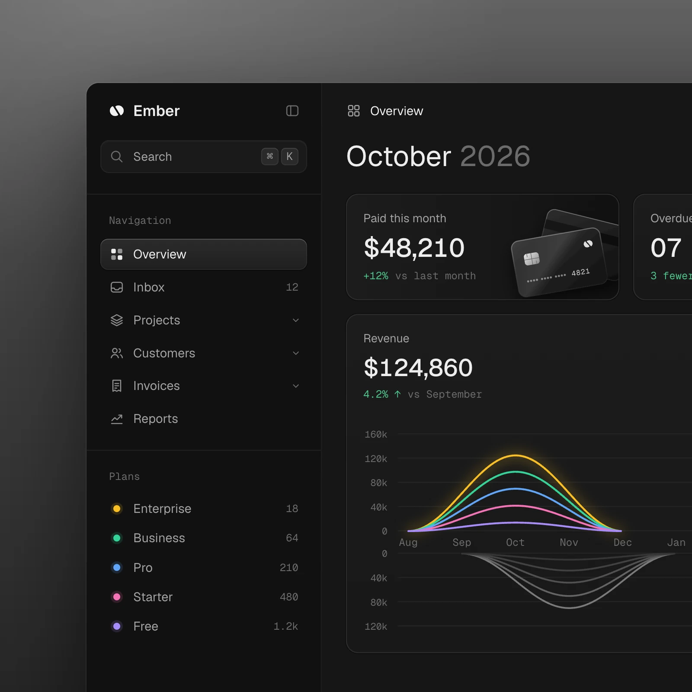

# 首页 unslop 审查与使用说明

日期：2026-11-07（Asia/Shanghai）

## 当前进度

已安装项目级技能 `.agents/skills/unslop`，已阅读技能和官方参考图，并完成首页直接调用链的静态审查。尚未修改业务页面。当前结论来自源码，未启动浏览器验证实际显示、数据或响应式表现。

技能来源：https://github.com/heydamir/unslop 。作者 Damir Sokolovsky（@heydamir），CC BY 4.0；安装内容保留原有署名。

## 查看效果

官方过程图，从左到右、从上到下阅读：


官方仪表盘完成参考：



这些是作者提供的参考图，不是当前粮油项目的截图，也不保证每次运行得到相同结果。当前项目继续遵循深色侧栏、浅灰背景、白卡片和蓝色主操作规范。

## 怎么使用

安装目录为本项目 `.agents/skills/unslop`，不是前端 npm 依赖。后续轮次可使用 `$unslop` 调用；如果客户端尚未发现技能，重新打开项目会话。

示例提示词：

```text
$unslop 审查当前项目首页，保留 Vue 2、Element UI、深色侧栏、浅灰背景和蓝色主操作。
先列出问题和设计方向，确认后只做必要的视觉打磨。
保留现有 API、权限、筛选条件、统计口径和导出行为。
```

普通文字也可以明确要求使用 unslop，并指定一个页面。流程是：查看页面、列出问题、确定方向、依次调整间距/颜色/图标/文案/字体/布局/细节/视觉/动效，再验证。技能由代理读取执行，没有独立的前端运行按钮。

## 首页审查

范围仅包括 `views/dashboard/index.vue`、它直接复用的 `views/statistics/ScenarioPage.vue`、`components/ChartSwitcher/index.vue` 及相关配置、布局和统计单测。

1. 首页没有发现明显的渐变、发光、Emoji 装饰或夸张文案；推荐轻量打磨。
2. 首页快捷入口中，采购为蓝色主按钮，销售为绿色成功按钮。绿色这里表示普通导航，可考虑采购保留主操作，销售和库存使用次要操作样式。
3. `ScenarioPage.vue` 的指标标签与数值间距为 10px。可调整为 12px，并给数值添加 `font-variant-numeric: tabular-nums`。只对 dashboard 场景生效。
4. 首页主明细、趋势和三个排行均复用图表组件，其图表统一高 400px。可以考虑让排行更紧凑，保留完整图表/表格切换与内容顺序。实际高度需浏览器检查后确定。
5. 首页复用了多个统计页面共用的组件。所有首页专用改动须限定在 dashboard 场景或通过具有现有默认值的可选展示参数传入，避免改变其他报表的显示和行为。

## 方案比较

| 方案 | 范围 | 取舍 |
| --- | --- | --- |
| A：轻量打磨（推荐） | 首页快捷入口、指标排版与间距 | 范围小，保留既有布局；变化较克制 |
| B：首页信息层级调整 | 在 A 上区分主图与排行高度 | 更易扫描，但需额外验证图表缩放、切换与窄屏显示 |
| C：重做整套后台视觉 | 布局和多个业务页面 | 当前缺乏必要性，且超出最小改动原则，不建议 |

## 推荐方向（待确认）

- 产品：为粮油业务人员提供进销存经营统计和业务入口。
- 性格：沉稳、清晰、精确。
- 场景：仓库台账与经营报表；保留现有后台中性色和蓝色主操作。
- 重点：真实指标与图表承载信息，操作区减少相互竞争的强调色。
- 特征：金额保留元、数量保留基础单位提示，数字使用等宽数字排版。

先实施 A。保留内容顺序、接口、数据、权限与加载/空数据/失败反馈；不新增统计指标、不编造增长率。B 作为后续可选项。

## 验证安排

本轮仅安装技能和编写审查文档，检查技能入口、引用文件、参考图片及脚本语法；不运行前后端全量测试。

后续修改页面时，在 frontend 目录运行：

```sh
npm run lint -- --no-fix src/views/dashboard/index.vue src/views/statistics/ScenarioPage.vue
npm run test:unit -- --runInBand tests/unit/statistics-page.spec.js
```

随后在可用浏览器中检查首页有/无统计权限、查询加载/失败/空数据、快捷入口权限和窄屏换行；目前这些运行时检查尚未执行。
